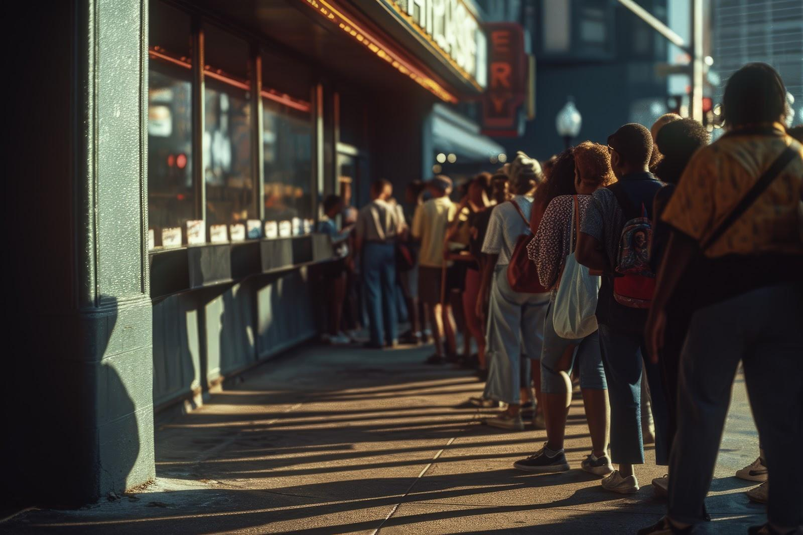
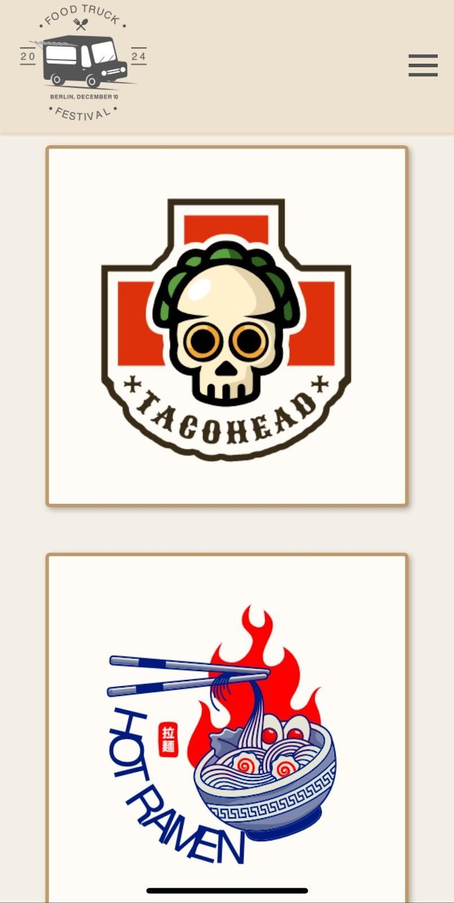
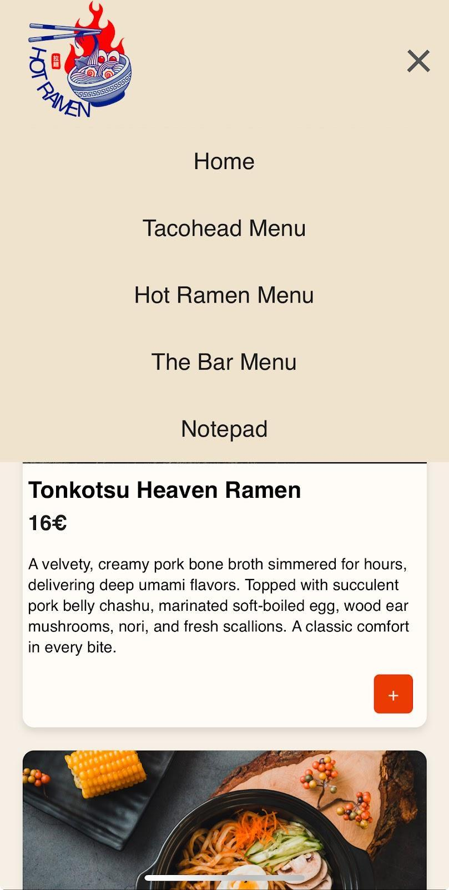
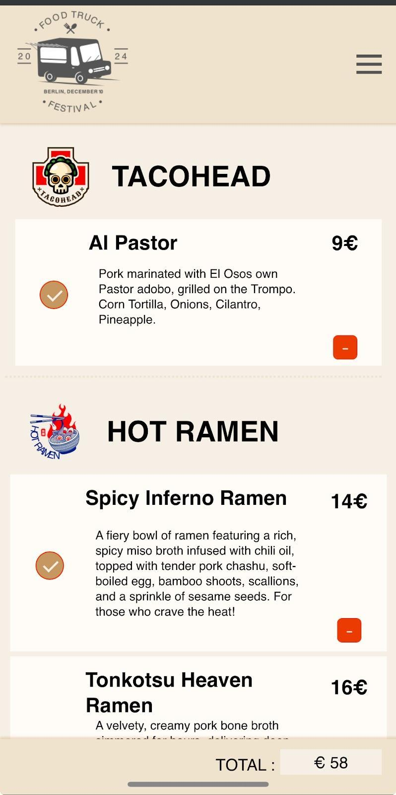
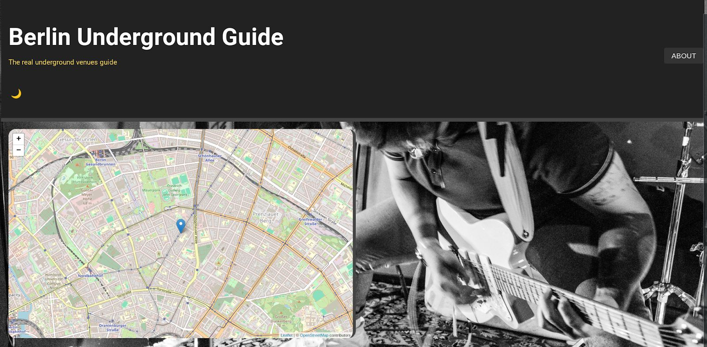
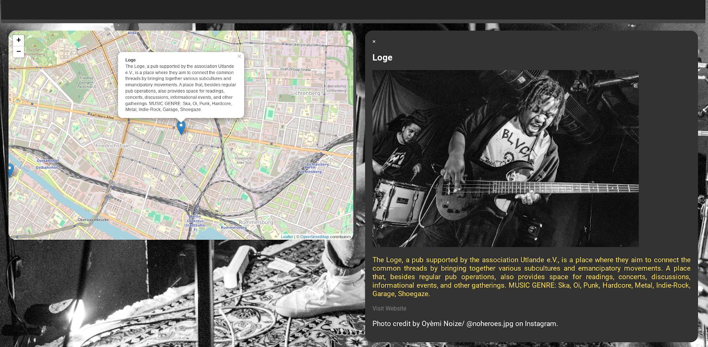
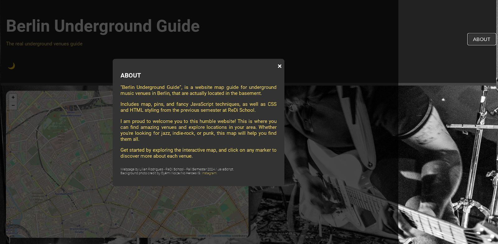
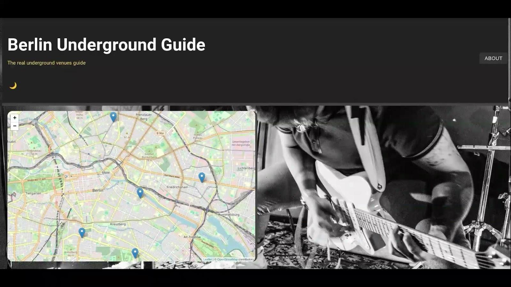
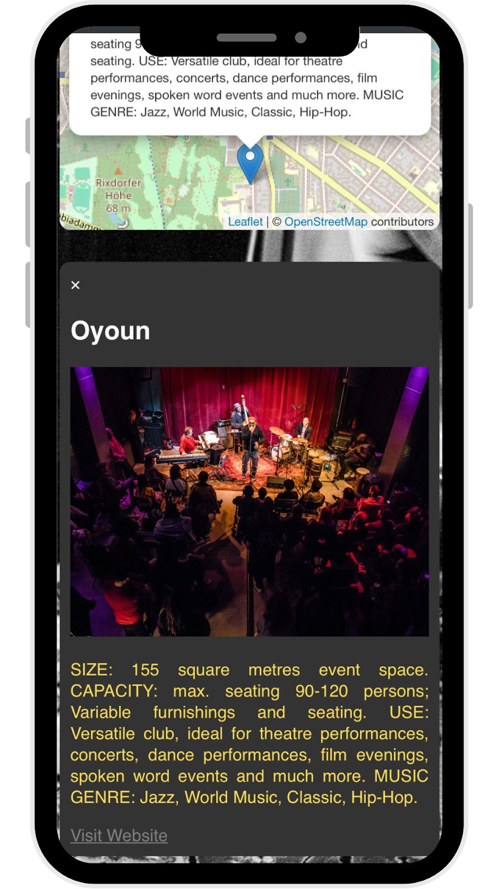
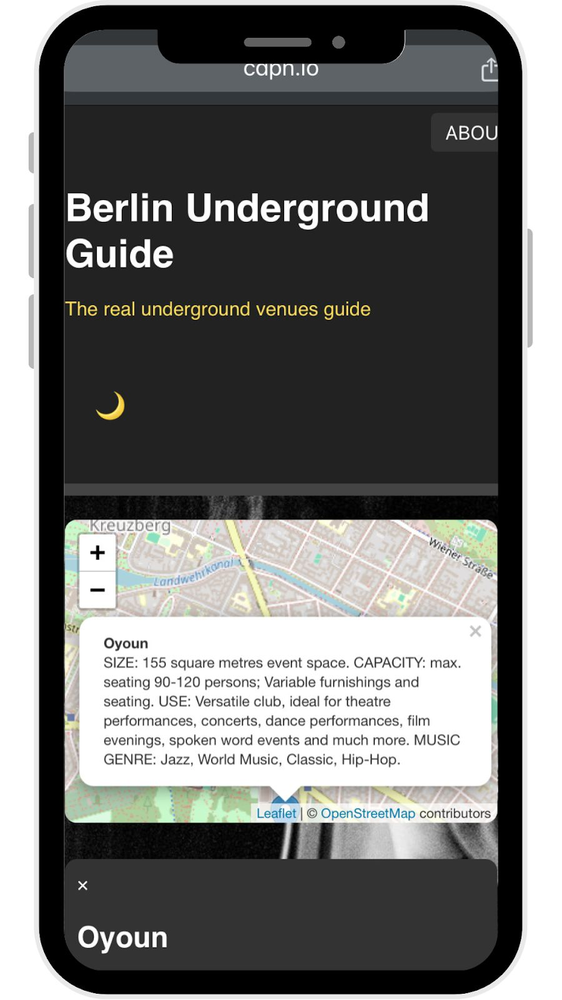

<!-- .slide: id="lesson16" -->

# JavaScript Course - Fall 2026

Lesson 16, Thursday, 2026-11-19

---

# Final Project Kick-Off 🚀

---

### Agenda

- **Project:** requirements & timeline
- **Inspiration:** ideas & examples
- **Teams:** groups & themes
- **Presenting:** guidelines
- **Check-out:** closing question

---

### Why do the project?

- **Hands-on learning:** apply your skills to a real project
- **Identify & improve:** find strengths, spot gaps
- **Showcase growth:** present your progress
- **Practice presenting:** public speaking in a safe space

---

### Project requirements

- **Team:** individual or 2-3 people
- **Topic:** your choice, with teacher guidance
- **Code:** a solution using JavaScript
- **Presentation:** with a live demo of an interactive web app or website

---

### Presentation requirements 🎬

- **Length:** max. 5 minutes
- **Mode:** short slides + live demo
- **Structure:**
  - **Intro:** project and problem solved
  - **Demo:** the live website
  - **Learnings:** what worked, what was hard

---

### Project Ideas 💡

- **Games:** quiz or trivia game
- **Productivity:** to-do list or tool
- **Web:** interactive landing page or form
- **APIs:** weather or news app
- **Your own:** realistic for the timeframe

---

### More ideas

- **Data viz:** flea markets in Berlin
- **Planning:** calendar for remote work
- **Lists:** grocery shopping list
- **AI:** AI in the browser
- **Showcase:** personal portfolio

---

### APIs

- **Local:** [Berlin data](https://daten.berlin.de/datensaetze/datenberlinde-metadaten)
- **Browse:** [Free APIs](https://free-apis.github.io/#/browse)
- **Directory:** [Public APIs](https://github.com/public-apis/public-apis)

---

### AI in the browser

**Chrome beta:** runs small AI models locally

```js
let model = await LanguageModel.create();
let answer = await model.prompt("Why is JavaScript awesome?");
// or detect language
let detector = await LanguageDetector.create();
let result = await detector.detect("Merci common ca va?");
```

**Docs:** https://developer.chrome.com/docs/ai/built-in

---

### Project Strategy

- **MVP:** define the minimum viable product
- **Tasks:** list what the MVP needs
  - break them down week by week
- **Build:** essentials first, "nice to have" later

---

### Projects from previous semesters

- [WhattaCook](https://github.com/katamatata/katamatata.github.io)
- [Plantastik](https://github.com/annamariaratajczak/plantastick)
- [Giphy CopyCat](https://github.com/ami-onodera/giphy)
- [Memory Game](https://github.com/TainaraCris1/Project_Memory_Game)
- [Tic-Tac-Toe](https://github.com/Amani-Maklad/Tic-Tac-Toe)

Next: two examples in more detail 👇

---

## Jacques
# Food Festival Menu

---

### Food Festival Menu – The Problem

<div style="display:grid; grid-template-columns:repeat(3, minmax(0, 1fr)); gap:12px; align-items:center;">
  
  
  
</div>

<small>Images and logos designed by Freepik (www.freepik.com)</small>

---

### Food Festival Menu – The Solution

<div style="display:grid; grid-template-columns:minmax(0, 1.3fr) repeat(3, minmax(0, 1fr)); gap:12px; align-items:center;">
  <div style="text-align:left; font-size:0.7em;">
    <strong>One Menu to rule them all.<br>
    One Menu to find them.<br>
    One notepad to bring them all and in the darkness bind them.</strong>
  </div>
  
  
  
</div>

---

### Food Festival Menu – How I did it

- **HTML and CSS**
  - Menu design and layout
  - Hamburger menu animation
- **JavaScript**
  - Navbar scroll animations
  - "Add to Notepad" button
  - Checkboxes for the total price

---

## Lilian
# Berlin Underground Guide

The real underground venues guide

<small>Web Development/JavaScript – ReDI School Berlin, Fall Semester 2024</small>

---

### Berlin Underground Guide – Introduction

**What:** a map guide to Berlin's hidden basement music venues

<div style="display:grid; grid-template-columns:repeat(3, minmax(0, 1fr)); gap:12px; align-items:center;">
  
  
  
</div>

**Demo:** [Live on CodePen](https://codepen.io/Lilian-Rodrigues/full/RNbaxJP)

---

### Berlin Underground Guide – Purpose & Motivation

- **Passion:** underground music + web development
- **Audience:** locals and visitors finding hidden places
- **Showcase:** HTML, CSS, JavaScript, Leaflet

---

### Berlin Underground Guide – Key features

<div style="display:grid; grid-template-columns:repeat(2, minmax(0, 1fr)); gap:20px; align-items:center;">
  <div style="text-align:left; font-size:0.65em;">
    <ol>
      <li><strong>Interactive map:</strong> Leaflet markers</li>
      <li><strong>Venue modals:</strong> image, text, link</li>
      <li><strong>Dark/light mode:</strong> theme toggle</li>
      <li><strong>About modal:</strong> site and creator</li>
    </ol>
  </div>
  
</div>

---

### Berlin Underground Guide – Technology stack

- **HTML5:** structure
- **CSS3:** responsive design, themes
- **JavaScript:** modals, markers, theme toggle
- **Leaflet.js:** interactive map
- **Google Fonts:** typography
- **Flickr:** picture hosting

---

### Berlin Underground Guide – Challenges & Solutions

<div style="display:grid; grid-template-columns:minmax(0, 1.4fr) repeat(2, minmax(0, 1fr)); gap:12px; align-items:center;">
  <ul style="font-size:0.7em; margin:0;">
    <li><strong>Data:</strong> map + venue info</li>
    <li><strong>Modals:</strong> neat venue display</li>
    <li><strong>Themes:</strong> dark and light mode</li>
    <li><strong>Mobile:</strong> responsive styling</li>
  </ul>
  
  
</div>

---

# 🎤 Project Presentation Guidelines

---

### Online Demo Day – structure

- **Intro (1 min):** project, problem, audience
- **Core:** your extra research – teach something new
- **Demo:** a real-world example
- **Conclusion (1 min):** next steps, challenges, lessons

---

### Useful tips for any presentation – KISS

**Keep it Short and Simple**

- **Structure:** keep it structured
- **Rehearse:** timebox yourself
- **Audience:** know your audience

---

### The 6x6 rule – for PowerPoint

- **Words:** max. 6 per line
- **Lines:** max. 6 per slide
- **Visuals:** images, icons, charts
- **Font size:** at least 14-20 pt
- **Delivery:** don't read off your slides

---

### Story format

- **Examples:** memorable and personal
- **Scene:** set characters and task
- **Arc:** intro → development → key insight → resolution → wrap-up
- **Drama:** build tension, resolve it at the end
- **Connection:** add humor and empathy

---

### Project phase timeline

- **Launch session:** this session
- **Work sessions:** project work only, attendance mandatory
- **Online Class Demo Day:** Dec 10th
- **On-site Demo Day:** Dec 11th, required for learners in Hamburg

---

### Online Class Demo Day – Dec 10th

- **Present:** every learner, to their class
- **Selection:** one project goes to the on-site Demo Day in Hamburg
- **Certificate:** attendance and presentation required
- **Submit:** Google Drive (shared by the ReDI Team), 1 day before class

---

### On-Site Demo Day – Dec 11th

- **Where:** in person, Hamburg
- **Who:** all learners in Hamburg – attendance required
- **Selection:** one project, chosen by ReDI
- **Format:** booth talks, 5-10 minutes, several times
- **Prep:** briefing and rehearsals from the ReDI Team

---

### Let's form groups! 👥

- **Teams:** work in your current study groups
- **Sheet:** fill in the [Group Forming Sheet](https://docs.google.com/spreadsheets/d/1cGi8wireyajPRoPKO_gknpWSep96URCKWojU8MLKLOw/edit?usp=sharing)
  - team members + project name
